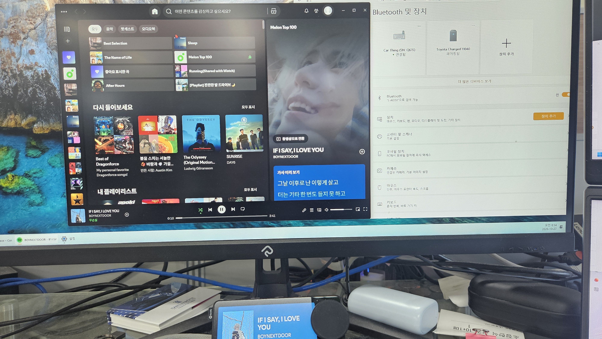

# Carthing Connector

Connect a stock Spotify Car Thing directly to your Windows PC or Android phone over Bluetooth, and use it to display and control media playback.

**No additional board or hardware modification is required.** Carthing Connector works with the device's original Spotify firmware and playback UI. Keep Car Thing powered and pair it with your PC or phone—no Raspberry Pi, replacement board, or firmware flashing is needed.

The Windows tray app and Android companion app send track information and album artwork to Car Thing and route playback controls back to the source device. They use operating-system media sessions, rather than a Spotify account API, so compatible media apps can also provide the playback source.



*Spotify on Windows and a stock Car Thing showing the same track in the device's native Spotify playback view.*

## Features

- Track title, artist, album artwork, and playback-state updates.
- Play/pause, previous track, and next track controls.
- Windows and Android media volume control using the Car Thing dial.
- Windows shuffle control and state synchronization when supported by the active media app.
- Two display modes: **External media** and **Spotify**. Spotify is the default when no mode is saved; explicit selections are preserved.
- Tray-based device selection, connection restart, and log access.
- Saved device and display-mode settings.
- A single Windows x64 executable using the separately installed .NET 10 Desktop Runtime; no PowerShell launcher needed.

Playback, artwork updates, volume, and bidirectional shuffle have been verified with the Spotify Windows app. Other apps must expose a Windows media session, and their available controls may differ.

## Windows and Android support

Status reflects the current source. **Verified** means observed on a physical Car Thing; **Implemented** means present in code without equivalent device confirmation; **Partial** means only the described subset is available. **Not implemented** does not mean the operating system makes a feature impossible. Older downloaded binaries may differ.

### Playback and Car Thing screens

| Feature | Windows | Android | Limits and dependencies |
|---|---|---|---|
| Track title, artist, album metadata | Verified | Verified | The media app must publish a media session and metadata. Album metadata does not include an album's track list. |
| Album artwork and track changes | Verified | Verified | Depends on app-provided artwork. Android currently reads metadata bitmaps; URI-only artwork is not fetched. |
| Play / pause, previous / next | Verified | Verified | Commands depend on the selected player's capabilities. Dispatch does not guarantee playback; state is read back afterward. |
| Dial volume up / down | Verified: default output device | Verified: music stream | These control system output/stream volume, not just Spotify. Android uses explicit public volume steps; fixed-volume outputs cannot be adjusted. |
| Playback position and duration | Implemented | Implemented | Depends on timeline data; live streams may have no useful duration. Displaying progress does not enable seeking. |
| Shuffle control and state | Verified with Spotify | Not implemented; disabled | Windows exposes shuffle state/control. Android's current framework adapter has no dedicated shuffle method; compat/Media3 or app custom actions require additional integration and player support. |
| Seeking | Not implemented | Not implemented | Both platforms have seek APIs. Connector mapping and player capability checks remain to be implemented. |
| Repeat mode | Not implemented | Not implemented | Windows has a repeat API. Android would require a compatible session/custom-action integration beyond the current adapter. |
| Like / save to Spotify library | Not implemented | Not implemented | Windows media-session controls expose no Spotify save command. Android ratings/custom actions are not a universal Spotify library-save contract. |
| Native Spotify playback screen | Verified | Verified | Uses the stock device UI with OS media data; does not sign in to a Spotify account. |
| External media screen | Verified | Implemented | Same media source, different stock UI. Native-only Home/preset behavior does not automatically apply to this mode. |
| Source app name above the track | Implemented | Verified | Native screen uses a local playlist context to show the app name. Android may briefly show a package ID before resolving the display name. |
| Home: current-track card | Implemented; shared tests pass | Verified | One local **Now Playing** card, not a Spotify library. Both GraphQL and `get_home` requests are supported. |
| Select the Home card | Implemented: resume current session | Return to playback screen verified | Only the currently advertised track is accepted. Physical confirmation covers navigation; the resume request is covered by automated tests. |
| Full playback queue | Partial: current item only | Partial: current item only | Windows' selected media API has no full-queue reader. Android can expose a session queue if the player supplies it, but this adapter does not read it yet. |
| Album / playlist library browsing | Not implemented | Not implemented; Spotify access refused in device probe | Windows media sessions are not a library API. Android MediaBrowser requires the provider's permission; Spotify 9.1.92.3058 returned no root to this connector. This is an app access restriction, not the absence of an Android browsing API. |
| Top preset buttons 1–4 | Partial: protocol experiments | Partial: protocol experiments | Native mode exposes four session-local test presets. Save/select requests are handled or observed, but real playlist/app-action mappings and persistent presets are not implemented. |
| Voice commands / microphone | Not implemented | Not implemented | The connector does not implement a voice-assistant backend. |
| Audio streaming through the connector | Not provided | Not provided | The Bluetooth companion link carries metadata and controls. Audio remains on the PC/phone's selected output. |

Windows API availability is documented in [GlobalSystemMediaTransportControlsSession](https://learn.microsoft.com/en-us/uwp/api/windows.media.control.globalsystemmediatransportcontrolssession). Android capabilities depend on the API layer and player: see [framework transport controls](https://developer.android.com/reference/android/media/session/MediaController.TransportControls), [session queues](https://developer.android.com/reference/android/media/session/MediaController#getQueue()), and [MediaBrowser access decisions](https://developer.android.com/reference/android/service/media/MediaBrowserService#onGetRoot(java.lang.String,int,android.os.Bundle)). The connector does not yet integrate Android compat/Media3 transport extensions.

### Connection, background operation, and distribution

| Feature | Windows | Android | Limits and dependencies |
|---|---|---|---|
| Stock device over Bluetooth Classic RFCOMM | Verified | Verified | Pair in OS settings first; no extra board or firmware replacement. |
| Media source selection | OS current media session | Playing session, then previous active session, then first available | Automatic selection; no manual media-app picker. Android requires notification-listener access. |
| Device / display-mode selection and saved settings | Tray menu | App setup screen | One selected Car Thing per connector session; saved selection does not create a Bluetooth pairing. |
| Background operation | Tray app | Foreground service; screen-off operation verified | Android keeps an ongoing service notification. OS process termination, battery restrictions, and force-stop can interrupt it. Neither platform guarantees operation while suspended. |
| Start after reboot | No built-in login startup option | Implemented; opt-in | Android starts after boot/unlock with required permissions. Reboot behavior has not yet been confirmed on the test device. |
| Connection recovery | Tray **Restart connection** | Automatic retry in automatic mode; manual mode stops on disconnect | Android automatic mode prefers the saved paired Car Thing, otherwise a unique name match; ambiguous matches require selection. Recovery after process death is not guaranteed. |
| Diagnostics | Tray shortcut to logs and packet captures | App-private captures | Captures contain media metadata. Android Release builds do not allow `adb run-as` access to private files. |
| Distribution | Single x64 EXE; .NET 10 Desktop Runtime required | ARM64 APK, Android 8.0+; runtime bundled | Android preview uses the existing development signing key. Matching signatures are required for in-place updates. |

Android uses a [connected-device foreground service](https://developer.android.com/develop/background-work/services/fgs), not an invisible permanent background process. See [Android setup and device evidence](docs/60_Android_Connector.md) and [publishing requirements](docs/58_Publishing.md).

## Display modes

| Mode | Car Thing display |
|---|---|
| External media | The device's external-media card, including the playback app name |
| Spotify | The device's native Spotify playback view, with artwork and playback controls |

Both modes use the active **media session on the PC or phone** as their source. Choosing Spotify mode changes the device UI; it does not connect the bridge to a Spotify account or turn local track identifiers into Spotify catalog IDs.

In Spotify display mode, the label above the track title shows the active media app's name (for example, Spotify or YouTube Music). Album information remains part of the track metadata.

The Home view exposes a **Now Playing** section with the current track's artwork, title, and artist. Selecting that card resumes the active media session. This is a local view of the current track, not a Spotify library or playlist download.

Select a mode from the tray menu. The app closes the current connection, starts listening again, and remembers the choice for the next launch.

## Preview downloads

The prepared distribution contains two files:

- `carthing-connector.exe`: Windows x64 tray app; requires .NET 10 Desktop Runtime (x64).
- `carthing-connector-android-preview.apk`: Android 8.0+ ARM64 Release preview, signed with the existing development key for in-place updates.

Local output: `dist/release/`. The APK is a non-debuggable Release build intended for testing, not a production-signed store release. Keep binary downloads in GitHub Releases rather than tracking them in Git.

## Getting started

You need a Windows x64 PC with Bluetooth Classic support and a stock Car Thing with its companion UI available.

1. Power on Car Thing and pair it with the PC in Windows Bluetooth settings.
2. Install **.NET 10 Desktop Runtime (Windows x64)** from the [official .NET download page](https://dotnet.microsoft.com/en-us/download/dotnet/10.0). Choose **Desktop Runtime**, not the plain .NET Runtime or ASP.NET Core Runtime. End users do not need the SDK.
3. Download and run `carthing-connector.exe`, or build it using the commands below. If prompted to install .NET, install the Desktop Runtime and run the EXE again.
4. Select the paired Car Thing when prompted. The app remembers this device.
5. Start playback in a compatible Windows media app. If Car Thing remains on its connection screen, select the PC on the device.
6. Right-click the tray icon to select a display mode, restart the connection, open logs, or exit.

The tray menu provides **Select device**, **Display mode**, **Restart connection**, **Open logs folder**, and **Exit**.

Only one connector instance runs per Windows session. Exit the running app before replacing its executable.

## Android app

An initial Android app is available under `android-connector/`. It uses a silent foreground-service notification while waiting for or maintaining a Car Thing connection. See [Android installation, supported controls, and build verification](docs/60_Android_Connector.md).

Pair Car Thing in Android Bluetooth settings, grant media access, and select **Connect**. The app displays connection status and offers Spotify or External media display modes. Enable **Start after reboot** to automatically select a paired Car Thing and wait for a connection after startup.

| Connection and settings | Ongoing connection notification |
|---|---|
|  |  |

The ongoing notification shows the connection status while the app screen is closed. Track information, artwork, playback controls, and volume have been verified on a physical device, including operation with the phone screen off.

## Build and test

Install the .NET 10 SDK on Windows, then run these commands from the repository root.

Build the Windows app:

```powershell
dotnet build windows-probe/CarThingProbe.csproj -c Release
```

Exit the running tray app, then create a tested, single-file Windows x64 distribution:

```powershell
.\Publish-CarThing.ps1
```

The script runs the core tests, publishes into a separate staging directory, and replaces `dist/carthing-connector/carthing-connector.exe` only after those steps succeed. It stops if the tray app is running. A failed test or publish leaves the existing EXE unchanged.

Copy that EXE to the destination PC and install .NET 10 Desktop Runtime (x64). Application dependencies are bundled; the .NET runtime is installed separately. Native components may be extracted automatically at launch. `dist/carthing-connector.build.json` records the source commit, working-tree status, build time, and EXE SHA256; it is not needed to run the app. Detailed logs and a per-build record are kept under `analysis/publish/`.

Run the script again after source changes to refresh the distribution. A normal Build updates `bin/` and `obj/`, not `dist/`. See the [publishing workflow](docs/58_Publishing.md).

Run the platform-independent protocol and adapter tests:

```powershell
dotnet run --project tests/CarThing.Core.Tests/CarThing.Core.Tests.csproj -c Release
```

These tests cover authentication, subscriptions, RPC handling, image caching, playback commands, both display modes, and stream-session integration using a fake media source. They do not require a connected Car Thing.

## Architecture

```text
Car Thing
    ↕ Bluetooth Classic RFCOMM
Windows Bluetooth adapter
    ↕ streams
CarThing.Core
    ↕ IMediaSource
Windows media sessions and output volume
```

| Project | Responsibility |
|---|---|
| `carthing-core/` | Platform-independent .NET 10 library: WAMP messages, MessagePack framing, display modes, command helpers, and image cache |
| `windows-probe/` | Windows tray app, Bluetooth connection, media-session integration, artwork conversion, and output volume |
| `tests/CarThing.Core.Tests/` | Protocol regression tests and stream/adapter integration tests |
| `android-connector/` | Android MAUI setup screen, connected-device foreground service, and phone media adapter |

The shared library accepts ordinary .NET streams and an `IMediaSource` implementation. The Android app reuses this core with its own RFCOMM transport, media-session adapter, and image conversion. MAUI belongs to the Android UI project, not the core. See the [Android setup and development APK](docs/60_Android_Connector.md).

## Current scope

- **Presets:** listing, save requests, and selection requests have been explored. Spotify mode currently uses session-local test presets; they are not mapped to real playlists or Windows actions.
- **Home/browse:** Home shows the current track; full album and playlist browsing is not implemented. See the platform comparison above.
- **Likes, seeking, and repeat:** not implemented.
- **Authentication:** the bridge implements the paired companion exchange used by the device, not Spotify cloud login.

## Settings and diagnostics

Settings and logs are stored independently of the executable location:

```text
%LocalAppData%/carthing-connector/
├── settings.json
└── logs/
    ├── app-*.log
    └── captures/
```

Settings include the selected Bluetooth device and display mode. Captures contain raw received/transmitted frames and decoded message logs for protocol investigation.

## Protocol notes

The implementation uses Bluetooth Classic RFCOMM, length-prefixed MessagePack frames, and WAMP-style messages. Research notes include APK analysis and physical-device observations.

The detailed documents are currently in Korean:

- [Protocol specification](docs/52_CarThing_연동_프로토콜_사양.md)
- [Shared library and platform adapter contract](docs/57_공통_프로토콜_라이브러리.md)
- [Windows tray app and deployment](docs/54_carthing-connector_트레이_앱.md)
- [Native Spotify UI, presets, and artwork experiments](docs/55_Spotify_화면_전환_시험.md)
- [Older APK API comparison](docs/56_구버전_APK_API_비교.md)
- [Initial APK analysis and Windows integration](docs/CarThing_APK_분석_및_Windows_연결.md)
- [Repository layout](docs/51_저장소_구성.md)

This is an independent project and is not affiliated with or endorsed by Spotify.


Display name: **Carthing Connector**. Executable names, package IDs, and existing settings paths remain unchanged.
